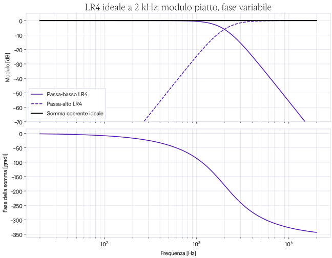
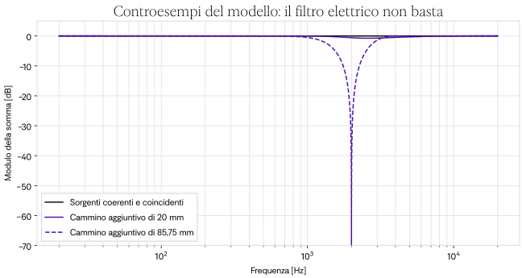

# PC, Raspberry Pi e crossover analogico: confronto e verifiche

Studio del 2026-11-20, richiesto dall'utente. Il progetto ha scelto il crossover attivo digitale, ADR-033, e preparato CamillaDSP sul PC Ubuntu già disponibile, ADR-045/046/049. Con ADR-051 l'utente rende obbligatorio anche l'ascolto con PC spento: si sviluppano modalità PC e autonoma su Raspberry Pi. La precedente descrizione dell'autonomia come opzionale è superata. Il [progetto aggiornato di ingressi, driver, finali e collaudo](63-sistema-autonomo-driver-e-collaudo.md) completa questo confronto; nessun Raspberry o interfaccia assente viene dichiarato collaudato.

## Domanda, metodo e qualità delle prove

La domanda è se il DSP su PC favorisca una coppia utilizzabile per home recording e ascolto e quali costi tecnici comporti rispetto a Raspberry Pi o analogico. Il [protocollo congelato prima dei calcoli](../research-vault/crossover-pc-pi-analogico/scope.md) dichiara modello, confronti e tolleranze. Le [fonti S1-S7](../research-vault/crossover-pc-pi-analogico/sources.md) sono documentazione primaria, Linkwitz Lab, nota applicativa e review scientifica. La ricerca è narrativa e mirata, non sistematica.

Tre livelli di prova rimangono distinti: risultati dedotti dal modello ideale e ricalcolati; segnali digitali già acquisiti dal nostro banco; misure ancora mancanti di diffusori, convertitori, stanza, consumi e carico. Le figure qui sono calcoli, non acquisizioni. In particolare 2 kHz è un esempio, non la scelta dei monitor.

## Tre scelte diverse da non sovrapporre

La risposta acustica desiderata è un requisito. Il crossover è una funzione di trasferimento. Analogico e digitale sono modi di realizzarla; PC e Raspberry Pi sono due possibili calcolatori per la realizzazione digitale. Il numero di finali dipende dall'architettura attiva: una coppia stereo a due vie richiede quattro canali di potenza, in entrambi i casi.

Qui l'alternativa analogica è attiva, a livello di linea e prima dei finali. Il [crossover passivo](52-crossover-passivo-o-attivo.md), con componenti fra un finale e i due altoparlanti, è un'altra architettura. La soluzione corrente non prevede quel crossover completo; eventuali protezioni locali del tweeter vanno ancora progettate e non sostituiscono la funzione acustica da ottenere.

| Aspetto | CamillaDSP sul PC esistente | CamillaDSP su Raspberry Pi dedicato | Crossover analogico attivo |
|---|---|---|---|
| Filtro | Parametri software, EQ e ritardi | Stesso modello di filtro, configurazione da validare sul nuovo host | Reti attive con componenti, guadagni e tolleranze |
| Interfaccia di uscita | Almeno quattro uscite indipendenti per la coppia | DAC/interfaccia con quattro canali effettivi, da scegliere | Due uscite di linea possono alimentare il crossover stereo, poi quattro vie analogiche |
| Autonomia dal PC della DAW | PC e sessione audio necessari nella soluzione attuale | Possibile, se sorgente e percorso d'ingresso del Pi sono davvero autonomi | Possibile con sorgente analogica e alimentazione del crossover |
| Profili mix/ascolto | Richiamo software pratico e ripetibile | Analogo vantaggio software | Possibili con EQ, commutazioni o regolazioni aggiuntive |
| Ritardi e fase | Linee di ritardo e filtri programmabili | Stesse possibilità, con limiti di CPU/I/O da misurare | Correzioni allpass possibili, con compromesso sulla banda |
| Complessità aggiunta | Routing, aggiornamenti, carico condiviso con DAW | Altro host, alimentazione, storage, I/O e collegamento alla DAW | PCB, operazionali, alimentazione, taratura e cablaggi |
| Costo iniziale | Riusa il PC; restano interfaccia, finali e protezioni | Aggiunge componenti rispetto al PC già disponibile | Può riusare una sorgente stereo; aggiunge l'elettronica analogica |
| Consumo e rumore | Da misurare nel reale uso DAW/ascolto | Da misurare a parità di funzione; il Pi acceso in più non implica risparmio | Dipendono da elettronica e sorgente effettiva |

La documentazione ufficiale CamillaDSP elenca binari x86 e ARM; quella Raspberry Pi documenta le modalità audio, ma non qualifica il nostro futuro DAC. Nessun prezzo di acquisto, consumo o numero di xrun dei tre sistemi è stato misurato in questo studio. Le cifre commerciali storiche in pagina 54 conservano la loro data e non sono un preventivo aggiornato.

Con un Pi separato va risolto anche il passaggio DAW → Pi. Un'interfaccia USB collegata come periferica a un host non si condivide semplicemente collegandola contemporaneamente a un secondo host con un cavo sdoppiato. Servirebbero un percorso audio compatibile e il relativo collaudo, per esempio una trasmissione o un ingresso dedicato; non sono funzioni già implementate nel progetto. È un requisito di integrazione, non un impedimento matematico all'uso del Pi.

## Dimostrazione 1: lo stesso LR4 esiste in analogico e digitale

Nel modello continuo poniamo omega_c=2*pi*fc. Due sezioni Butterworth del secondo ordine con Q=1/sqrt(2), in cascata, danno:

$$L(s)=\frac{\omega_c^4}{(s^2+\sqrt{2}\omega_cs+\omega_c^2)^2},\qquad H(s)=\frac{s^4}{(s^2+\sqrt{2}\omega_cs+\omega_c^2)^2}.$$

A s=j*omega_c entrambi valgono -1/2: ciascun ramo è a -6,0205999 dB e la somma coerente, con la stessa polarità, ha modulo 1. Sommando e fattorizzando:

$$L(s)+H(s)=\frac{s^2-\sqrt{2}\omega_cs+\omega_c^2}{s^2+\sqrt{2}\omega_cs+\omega_c^2}=A(s).$$

Per s=j*omega il numeratore è il coniugato del denominatore: modulo unitario, fase variabile. Quindi la somma ideale è allpass, non un segnale privo di sfasamento o un sistema a fase lineare. Il ritardo di gruppo del modello all'incrocio è:

$$\tau_g(\omega_c)=\frac{2\sqrt{2}}{\omega_c}=0{,}225079\ \mathrm{ms}\quad\text{per }f_c=2000\ \mathrm{Hz}.$$

Questa proprietà è indipendente dal contenitore elettronico che realizza il filtro. Linkwitz Lab e la review AES sono i riferimenti di contesto; fattorizzazione e valutazione numerica sono riprodotte dal codice del progetto. Per un diffusore reale occorre ancora la risposta degli altoparlanti montati.



Figura prodotta dal nostro modello: due rami, somma coerente e fase della somma. La linea piatta nel pannello superiore non implica fase costante nel pannello inferiore. Modello unitario senza driver, stanza o convertitori.

## Dimostrazione 2: biquad digitale e frequenza normalizzata

Un biquad normalizzato, sezione IIR[^1] del secondo ordine, si scrive:

$$y[n]=b_0x[n]+b_1x[n-1]+b_2x[n-2]-a_1y[n-1]-a_2y[n-2].$$

Con w0=2*pi*fc/fs e alpha=sin(w0)/(2Q), i coefficienti LPF/HPF del cookbook W3C si normalizzano dividendo per a0. Due sezioni identiche per ramo producono il LR4. A 2 kHz e 48 kHz il calcolo dà:

| Coefficienti di una sezione | Valori normalizzati |
|---|---|
| LP b0, b1, b2 | 0,01440144035; 0,02880288069; 0,01440144035 |
| HP b0, b1, b2 | 0,83089802127; -1,66179604255; 0,83089802127 |
| a0, a1, a2 | 1; -1,63299316186; 0,69059892324 |

Il massimo modulo dei poli di ciascuna sezione è 0,8310228175, minore di 1. I rami digitali hanno lo stesso livello di incrocio e somma a modulo unitario del modello ideale. Il confronto con l'analogico usa la frequenza deformata dalla trasformazione bilineare:

$$f_a=f_c\frac{\tan(\pi f/f_s)}{\tan(\pi f_c/f_s)}.$$

Confrontare direttamente le curve analogica e digitale alla stessa frequenza fino a Nyquist, ignorando questa trasformazione, sarebbe una verifica sbagliata. Il massimo errore complesso sul confronto correttamente mappato è circa 9,06e-15. Il calcolo usa float64 NumPy: non è una prova di identità bit per bit fra motori o piattaforme, né qualifica la quantizzazione di un diverso processore.

## Dimostrazione 3: l'analogico richiede Q e guadagno corretti

Nel Sallen-Key a componenti uguali della nota TI, la frequenza naturale e il Q sono:

$$f_0=\frac{1}{2\pi RC},\qquad Q=\frac{1}{3-K}.$$

Con K=1 si ottiene Q=0,5, non Butterworth. Per Q=1/sqrt(2) occorre K=3-sqrt(2)=1,5857864. Due sezioni hanno guadagno K^2=2,5147186, circa +8,00979 dB prima della normalizzazione; il progetto analogico deve quindi includere il corretto bilancio dei livelli. È un esempio della topologia descritta, non una distinta per saldare il nostro crossover.

Con fc=2 kHz e C=10 nF risulta R=7957,747 ohm. Nel solo modello di scala RC, con R ±1% e C ±5%, gli estremi sono:

$$f_{\min}=\frac{2000}{1{,}01\cdot1{,}05}=1885{,}903\ \mathrm{Hz},\qquad f_{\max}=\frac{2000}{0{,}99\cdot0{,}95}=2126{,}528\ \mathrm{Hz}.$$

Sono estremi deterministici di tolleranza, non un intervallo di confidenza. Non descrivono tutte le variazioni di Q o le correlazioni di quattro componenti reali. Componenti selezionati, topologie differenti e taratura possono ridurre gli scostamenti. Il digitale evita la tolleranza RC del calcolo, ma conserva errori di modello, quantizzazione e interfacce analogiche: nessuna superiorità sonora universale deriva dalla sola etichetta digitale.

## Dimostrazione 4: il filtro elettrico non garantisce la somma acustica

Per un lato stereo, in regime lineare, raccogliamo driver montato, guadagni, direttività, cammino e ambiente nelle funzioni complesse Gw e Gt:

$$P(f,\theta)=X(f)\left[L(f)G_w(f,\theta)+H(f)G_t(f,\theta)\right].$$

L'uguaglianza del solo filtro è utile ma non impone Gw=Gt. Per mostrare il problema isoliamo un ritardo puro, mantenendo uguali i livelli dei due contributi al punto di somma. Una differenza di cammino delta_d introduce:

$$\Delta t=\frac{\Delta d}{c},\qquad\Delta\phi=2\pi f\frac{\Delta d}{c},\qquad\left|P(f_c)/X(f_c)\right|=\left|\cos(\Delta\phi/2)\right|.$$

Con c=343 m/s ipotizzata e delta_d=20 mm si hanno 58,309 microsecondi, 2,798834 campioni a 48 kHz e 41,9825 gradi a 2 kHz: la somma all'incrocio è -0,596456 dB. Con delta_d=85,75 mm l'errore è mezzo periodo a 2 kHz e la somma ideale si annulla. Anche invertire la polarità di un ramo del LR4 ideale produce zero all'incrocio.

Questi sono controesempi calcolati modificando realmente le funzioni complesse. Il caso a livelli uguali isola il ritardo: non simula da solo la variazione 1/r, la direttività, le riflessioni o un driver reale. Il DSP può correggere un disallineamento misurato su un asse; non rende coincidenti due sorgenti in ogni direzione. Non si deduce la risposta della stanza dai nostri valori elettrici.



Il fondo a -70 dB della figura è un limite di visualizzazione. Non è un rumore misurato. Il valore al nullo è numericamente circa 1,61e-16 nel modello, non la previsione di una cancellazione perfetta nella stanza.

## Dimostrazione 5: che cosa significa davvero doppio uso

Se il profilo Ep è applicato ugualmente ai due rami di una cassa, prima della divisione o come fattore comune equivalente:

$$P_p=E_p(LG_w+HG_t)X,\qquad\frac{E_pLG_w}{E_pHG_t}=\frac{LG_w}{HG_t}\quad(E_p\ne0).$$

Il rapporto complesso fra i due contributi è preservato. Si può quindi costruire un profilo mix e uno ascolto sullo stesso crossover di base, senza cambiare arbitrariamente la relazione tra le vie. Il nostro esempio comune è uno shelving causale dolce; l'errore relativo calcolato nel rapporto è circa 6,07e-16. La proprietà assume sistema LTI[^2], stessi rami e assenza di clipping o interventi dinamici differenti.

Questo dimostra una possibilità architetturale, non che il diffusore rispetti già target, estensione o SPL desiderati. Un'EQ analogica comune può svolgere una funzione analoga: il doppio uso non è esclusivo del DSP. Il vantaggio pratico digitale è poter conservare e richiamare parametri, ritardi e livelli senza rifare reti e tarature meccaniche. I profili effettivi non sono ancora implementati.

## Headroom, escursione, rumore e latenza

Un aumento di +6 dB moltiplica l'ampiezza per 10^(6/20)=1,99526. Una sinusoide di picco 0,8 diventa 1,59621 senza attenuazione preventiva: supera il fondo scala nominale. Questo esempio non è un limite generale dei picchi di un filtro; per un sistema LTI stabile vale anche la maggiorazione temporale con la norma L1 dell'impulso, ||y||infinito <= ||h||1 ||x||infinito. Massimo guadagno in frequenza e massimo picco temporale non sono la stessa cosa.

In un carico resistivo ideale, raddoppiare la tensione quadruplica la potenza. Nel modello di sorgente piccola a pari pressione, distanza e superficie, l'escursione richiesta varia come 1/f^2: da 60 a 40 Hz aumenta di 2,25 volte. Cabinet, accordo e driver reali cambiano il limite operativo; l'EQ non crea gratuitamente escursione, dissipazione o volume di cassa.

Per confrontare il rumore di due convertitori si devono usare stesso riferimento e banda/pesatura. Solo in quel caso una dinamica DR espressa come rapporto RMS consente Vn=Vref*10^(-DR/20). Il guadagno del finale amplifica il rumore d'ingresso e si aggiunge il rumore proprio. Nessun valore di fruscio al tweeter si ricava dal nome dell'interfaccia: ADR-046 richiede la prova reale.

Un intervallo di 1024 campioni a 48 kHz dura 21,333 ms; non è la latenza end-to-end già misurata. Un FIR[^3] causale a fase lineare con N=1025 coefficienti ha ritardo di gruppo (N-1)/(2fs)=10,667 ms, cui si aggiunge il resto del percorso. Un IIR ha fase e ritardo dipendenti dalla frequenza. Anche l'analogico ha ritardo di gruppo, pur senza buffer digitali. Per registrazione in cuffia si deve progettare il monitoraggio del musicista separatamente dal percorso dei diffusori.

## Riproducibilità e stato delle prove

Eseguito dalla radice del repository Windows:

```powershell
cd E:\diy-2way-monitors-home
python tools/verifica-matematica-crossover.py --dest build/studio-crossover-20261120-v2
```

Il comando richiede una cartella nuova, NumPy, Matplotlib e i font Altro locali indicati dall'opzione --font-dir o dal kit già presente. Non installa dipendenze e non tocca motore DSP o hardware. Se la cartella esiste, scegliere un nuovo percorso: nessun overwrite automatico. Versioni osservate: Python 3.13.14, NumPy 2.2.2, Matplotlib 3.11.0. Il [rapporto completo](../research-vault/crossover-pc-pi-analogico/risultati-modello.json) conserva input, coefficienti, errori, ambiente e hash del sorgente; CSV e formati PDF/PNG/SVG delle figure sono nei derivati build.

Su 8194 punti deterministici tra 20 e 20000 Hz, incluso fc esatto, errore massimo di modulo LR4 analogico circa 5,56e-16; somma digitale circa 9,11e-15; uguaglianza con l'allpass circa 6,76e-16. Non sono 8194 esperimenti indipendenti e non si ricava un intervallo statistico. I controesempi di polarità e ritardo sono verificati separatamente.

Il banco del 19 novembre resta una prova diversa: CamillaDSP reale su grafo virtuale, acquisizioni, volume, mute e scambio dei lati. Il modello di questo documento spiega perché aspettarsi certi risultati e quali conclusioni non seguono da essi. Per completare i monitor servono dati dei driver in cassa, mappa e guadagni delle quattro uscite, livelli e protezioni, latenza e stabilità sotto DAW, ascolto e misure nella stanza.

## Scelta operativa allo stato corrente

Si sviluppano entrambe le modalità, PC per la DAW e Raspberry Pi per CD/riproduttori a PC spento, ADR-051. La proposta riusa un'interfaccia USB collegata a un solo host alla volta, con commutazione da qualificare; in alternativa si sposta il cavo a impianto silenziato. I filtri matematici sono riutilizzabili, mentre I/O, clock, avvio e latenza richiedono prove su ciascun host. L'analogico attivo rimane il confronto alternativo. Due crossover completi in serie richiederebbero un nuovo progetto della funzione complessiva.

La differenza energetica richiede misure. Per un delta di potenza ipotetico DeltaP, l'energia annua è DeltaP*t/1000 kWh: 5 W o 15 W per 8 ore al giorno significano 14,6 o 43,8 kWh/anno. Sono scenari, non consumi di PC o Pi misurati. La spesa totale include elettronica aggiuntiva, integrazione, esercizio e manutenzione: non è dimostrato che la piattaforma con meno watt nominali sia la più economica per tutti gli usi.

Rimandi: [manuale tecnico](61-camilladsp-manuale-tecnico.md), [guida quotidiana](10-ambiente/camilladsp-uso-quotidiano.md), [brief](../research-vault/crossover-pc-pi-analogico/brief.md), [review e limiti](../research-vault/crossover-pc-pi-analogico/review.md), [Linkwitz Lab prioritario](../research-vault/web/linkwitzlab-active-filters.md), [indice generale](INDICE-RAGIONATO.md).

[^1]: Infinite Impulse Response: filtro ricorsivo la cui risposta all'impulso può proseguire indefinitamente, pur decadendo se stabile.
[^2]: Linear Time-Invariant: sistema lineare e invariabile nel tempo. Consente sovrapposizione e descrizione con una funzione di trasferimento fissa.
[^3]: Finite Impulse Response: filtro con risposta all'impulso di lunghezza finita; la fase lineare richiede una struttura appropriata dei coefficienti, non segue dal solo nome FIR.
