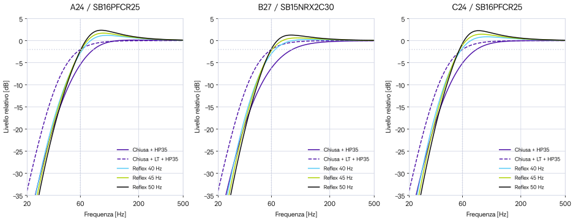
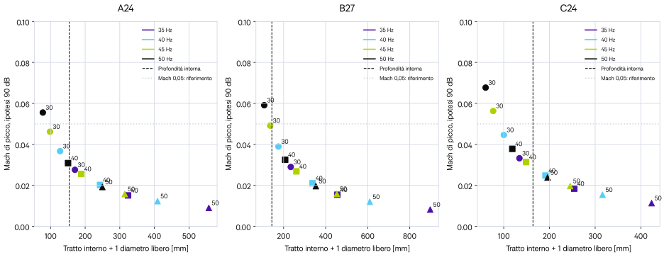
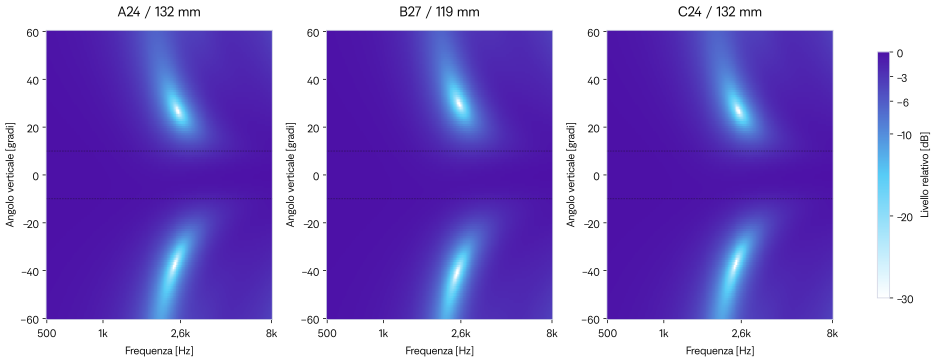
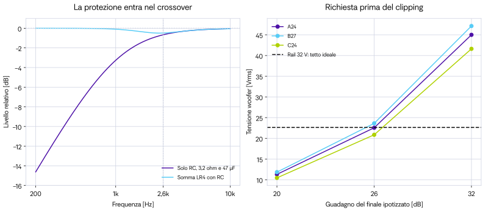

# Reflex, direttività e cabinet: progetto nominale completato

Stato del 25 novembre 2026. Questa pagina completa i confronti e i dettagli geometrici rimasti aperti nella [relazione 63](63-sistema-autonomo-driver-e-collaudo.md). I calcoli, le tavole e gli assiemi sono stati eseguiti; rimangono nominali finché non esistono misure degli esemplari e del sistema montato. Le verifiche fisiche restano sospese per ADR-055. Nessun acquisto, taglio o nuovo profilo operativo è autorizzato da questa consegna.

## Risultato e scelta di continuità

A24 chiusa con SB16/SB26 rimane la base di studio già proposta. La trasformazione LT nominale più HP35 raggiunge il bersaglio matematico a 60 Hz; il confronto reflex ora quantifica un'alternativa senza nascondere condotto, occupazione e velocità. C24 dà più margine al reflex, mentre A24 impone compromessi più stretti. Non viene cambiata automaticamente la base del progetto sulla sola simulazione.

Il [rapporto numerico](../research-vault/completamento-20261125/risultati.json) contiene 108 scenari reflex, 27 scenari di incrocio/offset e 18 ipotesi elettriche. Conserva anche i condotti che non entrano: 36 scenari rispettano la condizione geometrica rettilinea, contando tre valori di perdita per geometria. Le figure sono direttamente apribili: [chiusa/reflex](figure/completamento-20261125/chiusa-reflex.svg), [condotto](figure/completamento-20261125/condotto-ingombro-velocita.svg), [direttività](figure/completamento-20261125/direttivita-ideale.svg), [condensatore e livelli](figure/completamento-20261125/condensatore-e-livelli.svg).

## Il circuito reflex e la sua verifica



Il modello usa frequenza normalizzata $z=jf/f_s$, rapporto $h=f_b/f_s$, rapporto dei volumi $\alpha=V_{as}/V_b$ e resistenza del condotto rappresentata da $Q_p$. Si risolve l'ammettenza della cavità; non si divide per un'impedenza infinita nel punto di accordo ideale.

$$ Y(z)=z+\frac{h^2}{z+h/Q_p},\qquad D(z)=\left(z+\frac{1}{Q_{ts}}+\frac{1}{z}\right)Y(z)+\alpha . $$

$$ H_w=\frac{zY}{D},\qquad H_p=-\frac{zh^2}{(z+h/Q_p)D},\qquad H_{tot}=H_w+H_p=\frac{z^2}{D}. $$

Il segno del condotto è parte del risultato: sotto accordo i contributi possono cancellarsi. La prova modifica quel segno, osserva il fallimento e verifica il ripristino del sorgente. Nel caso senza perdite, con $h=1$, $\alpha=\sqrt{2}$ e $Q_{ts}=\sin(\pi/8)$, il modello coincide con un Butterworth del quarto ordine: modulo $1/\sqrt{2}$ a $f_b$ e pendenza asintotica di 24 dB/ottava. All'accordo ideale la corsa del cono si annulla mentre il condotto continua a emettere.

Il contesto bibliografico è il lavoro di [Small, 1973, verificato presso AES](https://aes.org/publications/elibrary/elibrary-page/?id=1967). In questa sessione sono stati letti metadati e abstract; non si dichiara una lettura integrale dell'articolo. Il circuito qui è derivato esplicitamente e provato sui casi analitici sopra. Sono omessi perdite della cassa, induttanza della bobina, compressione e comportamento turbolento: i valori $Q_p=5,10,20$ sono scenari, non misure.

## Lunghezza, volume e velocità del condotto



Il volume utile e la lunghezza si calcolano insieme. Il tubo occupa volume nella sola porzione interna alla cavità; il tratto che attraversa il pannello non viene sottratto una seconda volta. La correzione totale delle estremità è assunta pari a 1,46 raggi interni; parete del tubo 2 mm. Queste ipotesi andranno confrontate con il condotto effettivo.

$$ f_b=\frac{c}{2\pi}\sqrt{\frac{A_i}{V_b L_{eff}}},\qquad L_{eff}=L+1{,}46r,\qquad V_b=V_0-A_o(L-t). $$

Qui $L$ è la lunghezza fisica complessiva, $t$ lo spessore del pannello e $A_i,A_o$ le aree interna ed esterna del tubo. Si seleziona la soluzione positiva che lascia un volume utile fisico. La condizione di ingombro richiede il tratto interno più un diametro libero davanti alla bocca; non include una flangia commerciale o curve non ancora progettate.

Il volume $V_0$ sottrae 1,5 L di occupazione complessiva ipotizzata, già comprensiva del rinforzo. Non è il volume misurato di driver, materiale fonoassorbente e cablaggi. Il conto attuale non somma il rinforzo una seconda volta.

| Cabinet | Woofer | Volume prima del tubo L | Guadagno massimo LT+HP35 dB |
|---|---|---|---|
| A24 | SB16 | 9,664 | 3,28 |
| B27 | SB15 | 7,237 | 3,68 |
| C24 | SB16 | 12,016 | 2,60 |

La tabella seguente estrae quattro casi con $Q_p=10$. La risposta include HP35 e nessuna EQ reflex. Velocità ed escursione sono massimi fra 20 e 500 Hz per un livello di passabanda ipotetico di 90 dB SPL RMS sinusoidali, singolo diffusore in spazio intero a un metro. Non si deducono SPL reale, margine termico o rumore del condotto.

| Cabinet | Accordo Hz | Diametro mm | Lunghezza totale mm | Risposta 60 Hz dB | Mach picco | Corsa picco mm |
|---|---|---|---|---|---|---|
| A24 | 40 | 30 | 115,6 | -2,78 | 0,037 | 2,47 |
| A24 | 50 | 40 | 128,5 | -2,32 | 0,031 | 2,28 |
| B27 | 45 | 30 | 123,8 | -2,28 | 0,049 | 3,30 |
| C24 | 40 | 30 | 88,2 | -1,72 | 0,045 | 2,60 |

Il caso C24/40 Hz è interessante per il bersaglio nominale a 60 Hz; non basta a preferirlo al cabinet chiuso. Il riferimento Mach 0,05 è soltanto una soglia di confronto ipotizzata. Bocche, posizione del tubo, turbolenza, risonanze longitudinali e compressione possono cambiare il giudizio. Le lunghezze più grandi restano nel rapporto con stato geometrico negativo.

## Direttività e centri acustici



Per ciascun driver si considera un pistone di area equivalente alla $S_d$ pubblicata. Il modello di apertura circolare è il punto di partenza descritto da [Daniel A. Russell, Penn State](https://www.acs.psu.edu/drussell/demos/baffledpiston/baffledpiston.html); non ne vengono riprodotte immagini o animazioni. Il diagramma è normalizzato e non sostituisce le risposte complesse del driver sul baffle reale.

$$ D(\theta,f)=\frac{2J_1(ka\sin\theta)}{ka\sin\theta},\qquad a=\sqrt{S_d/\pi},\quad k=2\pi f/c . $$

Il valore sull'asse è uno; oltre il primo nullo si conserva anche il segno. Il programma integra l'apertura con quadratura deterministica, senza installare SciPy. La prova usa il valore indipendente $2J_1(1)=0{,}88010117149$ e il primo zero a 3,83170597021.

Alla somma LR4 si applicano il cammino verticale e un offset acustico ipotetico. Nel piano orizzontale l'interasse verticale non produce lo stesso ritardo.

$$ H=H_{LP}D_w+H_{HP}D_t e^{jk(d\sin\theta+\Delta z\cos\theta)} . $$

Sono esplorati incroci a 2,0/2,6/3,2 kHz e offset -20/0/+20 mm. I due estremi di incrocio sono scenari matematici, non nuove raccomandazioni di potenza per il tweeter. Senza offset e senza condensatore, a 2,6 kHz e ±10° il calcolo dà -1,52 dB per SB16/interasse 132 mm e -1,20 dB per SB15/interasse 119 mm. Con offset +20 mm, A24 arriva a -5,70 dB da un lato: la geometria da sola non dimostra il criterio fuori asse. Non viene inventata una compensazione di ritardo da un disegno meccanico.

## Condensatore e livelli: che cosa ora è calcolato



Il condensatore da 47 µF viene incluso nella somma, con il solo carico resistivo dichiarato di 3,2 ohm. Il suo polo è 1058,21 Hz; a 2,6 kHz il ramo perde 0,666 dB e anticipa di 22,15°. La somma dei due rami ideali scende di 0,489 dB sull'asse. Non è corretto aggiungere quel componente dopo aver congelato fase e livello del crossover.

$$ H_C(j\omega)=\frac{j\omega RC}{1+j\omega RC}. $$

Le ipotesi elettriche partono da +16 dBu dell'interfaccia, preguadagno -12 dB e limite software di sviluppo Main -6 dB. Per il ramo woofer si conserva il massimo della LT+HP35 nominale e il margine superiore dello shelving di ascolto. I guadagni 20/26/32 dB appartengono agli scenari, non al Fosi V3 misurato. Le tensioni sono richieste teoriche prima del clipping.

| Cabinet, modo ascolto | Guadagno ipotetico dB | Richiesta woofer Vrms | Equivalente resistivo 8 ohm W |
|---|---|---|---|
| A24 | 20 | 11,30 | 15,97 |
| A24 | 26 | 22,55 | 63,56 |
| A24 | 32 | 44,99 | 253,03 |
| B27 | 26 | 23,62 | 69,72 |
| C24 | 26 | 20,85 | 54,36 |

Con alimentazione 32 V, il tetto ideale BTL è $32/\sqrt{2}=22{,}63$ Vrms prima di ogni caduta e limite di corrente. I 44,99 Vrms del caso A24/32 dB sono perciò una richiesta impossibile in quell'ipotesi, non potenza disponibile. Nemmeno 22,55 Vrms autorizza 63,56 W continui: la vicinanza al limite ideale e la tenuta del driver richiedono taratura. La potenza IEC del tweeter è dichiarata dal produttore con passa-alto Butterworth a 2600 Hz, 12 dB/ottava; non è una specifica a banda intera.

## Cabinet, frontali e distinta

I disegni ufficiali di [SB16](https://sbacoustics.com/wp-content/uploads/2024/01/6in-SB16PFCR25-8.pdf), [SB15](https://sbacoustics.com/wp-content/uploads/2020/02/5in-SB15NRX2C30-8.pdf) e [SB26](https://sbacoustics.com/wp-content/uploads/2020/02/SB26STCN-C000-4.pdf) sono stati riletti e ispezionati. Il diametro posteriore del cestello viene distinto dal cerchio dei fissaggi. Il gioco di un millimetro sul diametro e la profondità di incasso uguale alla flangia sono scelte nominali da correggere sul processo reale.

| Variante | Taglio woofer mm | Incasso woofer mm × profondità | Taglio tweeter mm | Incasso tweeter mm × profondità | Interasse mm |
|---|---|---|---|---|---|
| A24/C24 | 145,5 | 177 × 4,1 | 47,15 | 73 × 3 | 132 |
| B27 | 124,9 | 151 × 6,5 | 47,15 | 73 × 3 | 119 |

I centri dei quattro fissaggi seguono i cerchi di targa; rimangono croci di costruzione, perché un foro pilota dipende dal fissaggio scelto. Il ponte nominale fra i due incassi è 7 mm. Il rinforzo è un settimo pannello con finestra, bordo 20 mm, arretramento di 20 mm dal lato interno del frontale e quota inferiore 201 mm. L'arretramento evita l'inviluppo conservativo del tweeter. Il modello controlla collisioni fra pannelli e con gli inviluppi dei driver.

| Cabinet | Legno per diffusore L | Solidi di legno | Distinta per coppia |
|---|---|---|---|
| A24 | 6,639 | 7 | 14 pezzi, prima di sfridi e prove di fresatura |
| B27 | 5,844 | 7 | 14 pezzi, prima di sfridi e prove di fresatura |
| C24 | 7,455 | 7 | 14 pezzi, prima di sfridi e prove di fresatura |

Le giunzioni sono a battuta incollata nel modello, senza una verifica strutturale della colla o del serraggio. Sigillatura, assorbente, passacavi e terminali non hanno ingombri esecutivi definitivi: rimangono compresi nell'occupazione nominale da riscontrare. Non si inventano fresature per connettori ancora da scegliere.

I file della [consegna locale](../build/consegna-completamento-20261125/README.md) comprendono FCStd modificabili, STEP, DXF, tavole PDF/SVG e distinta CSV. FreeCAD 1.1.4 ha verificato riapertura, sette solidi, volumi, assenza di sovrapposizioni e STEP reimportati. Una variazione della larghezza di 10 mm è stata ricomputata e ripristinata; il raggio deliberatamente errato ha fatto fallire il confronto dei volumi. CADCraft 0.20.1 ha riletto dodici profili per variante, verificando area, perimetro, centro e millimetri.

## Sequenza replicabile eseguita

Sulla postazione Windows, dalla radice di questo repository:

```powershell
cd "E:/diy-2way-monitors-home"
python tools/studio_completamento.py
python tools/figure_completamento.py
python tools/cabinet-dettagli-cadcraft.py --out build/completamento-20261125-cadcraft-verificato
python tools/collauda-cabinet-dettagli.py --host studio --out build/completamento-20261125-freecad-verificato --gui
python tools/consegna_documenti.py
python tools/consegna_completamento.py
python -m pytest tools/test_acustica_cabinet.py tools/test_progetto_cabinet.py tools/test_studio_completamento.py tools/test_consegna_cabinet.py tools/test_figure_completamento.py tools/test_consegna_completamento.py -q
python tools/studio_completamento.py --check
python tools/figure_completamento.py --check
python tools/consegna_completamento.py --check
```

I comandi di generazione CAD e figure richiedono destinazioni di lavoro nuove. Con risultati già presenti, si eseguono prima i controlli; per rigenerare si conserva la cartella precedente e si ricreano i percorsi indicati. Gli SVG pubblicati invariati vengono riconosciuti, quelli cambiati passano dal generatore con archivio della versione precedente. Il nome SSH del collaudo è quello della postazione su cui il comando è stato eseguito; su un clone va passato il proprio alias verificato. FreeCAD riceve soltanto il banco temporaneo; non vengono modificati servizi audio o installazioni ordinarie e non vengono rimossi file remoti.

## Troubleshooting osservato

### Ricostruire senza il vecchio kit in build

La prova del 25 novembre successiva a MS-319 ha estratto i soli sorgenti del commit dcb5e18. I generatori non trovavano i font perché li cercavano nella copia ignorata di un kit precedente; tre test della consegna richiedevano anche CAD e PDF già generati. I verdi precedenti descrivevano la postazione su cui erano stati eseguiti e non dimostravano quel caso.

La selezione condivisa in tools/font_intrawelt.py usa prima l'argomento esplicito, poi INTRAWELT_FONT_DIR, quindi la skill dell'account attivo e i font installati. Un percorso esplicito incompleto fallisce; non viene sostituita la famiglia tipografica. Le figure registrano gli hash dei font, le tavole anche quello del modulo che li seleziona. Nessun font viene installato o pubblicato nel repository. Per le figure è disponibile --font-dir; per le tavole resta --font.

I test del manifesto costruiscono file opachi in una cartella temporanea e verificano composizione e alterazioni prima/dopo la firma. Non attestano la validità di un FCStd o di uno STEP. Questa rimane coperta dai generatori e dai collaudi reali. tools/test_ricostruzione_sorgenti.py esegue grafici e CADCraft da una copia senza i vecchi build e confronta gli SVG ricostruiti con le figure correnti; prova anche il rifiuto della risorsa mancante. I comandi osservati sulla postazione sono:

```powershell
cd "E:/diy-2way-monitors-home"
python tools/test_font_intrawelt.py
python tools/test_ricostruzione_sorgenti.py
python tools/test_consegna_completamento.py
```

La ricostruzione del kit finale richiede ancora i CAD realmente collaudati e il PDF corrente: le fixture dei test non li sostituiscono. Le prove su cartelle temporanee richiedono i permessi appropriati nell'ambiente Windows, come descritto sotto.

### FreeCAD rifiuta un alias del foglio

Osservato su Ubuntu il 25 novembre, FreeCAD 1.1.4: gli alias W, H e T vengono rifiutati, mentre D e i nomi prefissati DimW/DimH/DimT sono accettati. Una prova sul foglio nudo ha isolato il problema prima di cambiare il modello. La correzione usa il prefisso Dim per tutte le quote. Il primo rapporto conserva il fallimento; il successivo collaudo dei solidi e la prova negativa sono riusciti.

### Il sandbox Windows nega il file temporaneo della prova

Osservato il 25 novembre: la suite del rapporto ha incontrato PermissionError nella cartella temporanea, prima di produrre il JSON. La stessa suite eseguita con il permesso di esecuzione appropriato passa, inclusi alterazione del risultato e pulizia. Non è stato cambiato il codice fisico per aggirare il problema.

### La vista PNG del CAD ha sfondo scuro

L'esportazione PNG predefinita di CADCraft usa il fondo del modello. Le tavole PDF/SVG sono su carta bianca; la verifica di stampa è stata fatta sul PDF reso con PdfCraft. Le viste FreeCAD usano impostazioni GUI isolate e colori del design system, senza cambiare le preferenze ordinarie del proprietario.
