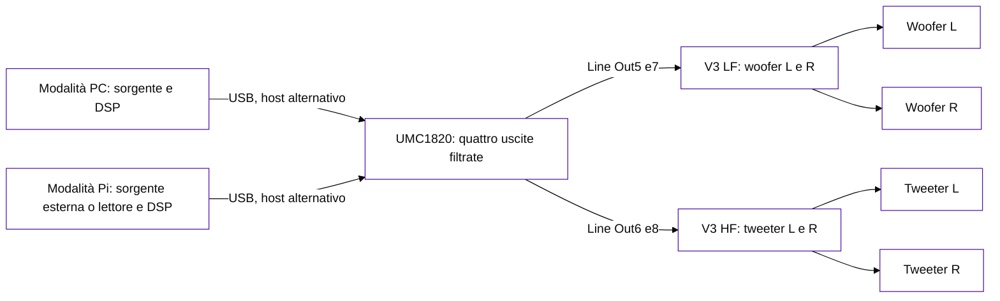

# Catena di riferimento e dipendenze del progetto esecutivo

Revisione del 26 novembre 2026, MS-323. Il proprietario conferma i due Fosi V3 stereo come base di sviluppo, con priorità al costo, dopo il confronto con due A800. La scelta consolida ADR-053 e viene registrata in ADR-058; non autorizza acquisti, tagli o collegamenti. Le verifiche fisiche restano sospese ADR-055.

Questo documento e [catena-riferimento.json](../data/catena-riferimento.json) conservano componenti, quantità, mappa nominale e revisione commerciale corrente. Il [capitolo63](63-sistema-autonomo-driver-e-collaudo.md) rimane la relazione tecnica dei modelli e del controllo; il [capitolo64](64-reflex-direttivita-e-cabinet-nominale.md) conserva CAD e limiti nominali. Metodo, coperture e recuperi non riusciti sono nel [topic di ricerca](../research-vault/catena-riferimento-20261126/sources.md).

## Base consolidata per proseguire

| Elemento | Quantità e base | Funzione e limite |
|---|---|---|
| Interfaccia |1 UMC1820, condivisa a host alternativo | Otto ingressi analogici nominali; cuffie e quattro vie separate. Identità e mappa ALSA fisiche non ancora qualificate. |
| Host PC | Ubuntu Studio già preparato | Registrazione e DSP sul PC; installazione del pannello già verificata nel suo perimetro. |
| Host autonomo |1 Pi4 Model B2GB, alimentatore ufficiale15W, microSD e contenitore ventilato | PC spento: Pi ospita il DSP. Variante di risorse proposta, non benchmark ARM. |
| Cabinet |2 A24 chiusi,220×190×430mm, MDF18mm | Geometria nominale già sviluppata; nessun ordine di taglio. |
| Woofer |2 SB16PFCR25-8, nominalmente8ohm | Base già simulata; una unità per cassa. |
| Tweeter |2 SB26STCN-C000-4, nominalmente4ohm | Una unità per cassa; protezione e filtro da qualificare. |
| Finali |2 Fosi V3 stereo con2 alimentatori32V/5A | Un finale per i due woofer, l'altro per i due tweeter; esterni ai cabinet. |
| Misura |1 Dayton EMM-6 candidato, cavo XLR e asta | Riuso dell'interfaccia. File individuale e riferimento di misura ancora da acquisire/qualificare. |

La base conserva una sola coppia e riusa interfaccia e finali fra le due modalità. Non aggiunge un secondo DAC multicanale o un crossover passivo completo. SB15/B27 resta un'alternativa geometrica se le verifiche future rendessero inadatta A24; non è una seconda coppia da comprare. I dati nominali dei driver e i disegni di riferimento sono quelli [SB16](https://sbacoustics.com/wp-content/uploads/2024/01/6in-SB16PFCR25-8.pdf) e [SB26](https://sbacoustics.com/wp-content/uploads/2020/02/SB26STCN-C000-4.pdf).

## Percorsi completi e proprietà dell'interfaccia

In modalità PC, la DAW[^1] o il lettore manda lo stereo al percorso PipeWire/CamillaDSP del PC; i quattro segnali filtrati arrivano alle uscite dell'interfaccia. La registrazione mantiene gli ingressi al PC e il musicista usa uno stereo cuffie distinto dalle vie filtrate.

In modalità autonoma, il PC può essere spento. La sorgente digitale entra nella UMC1820 e passa via USB al DSP sul Pi, poi torna alle uscite analogiche. Per una sorgente analogica si usano gli ingressi di linea; per file/rete il lettore sul Pi richiede il percorso ALSA già previsto. Sono modalità alternative: un solo host controlla la connessione USB della scheda. Il trasferimento del cavo e l'eventuale switch rimangono parte della qualifica differita, con sequenza silenziata.

Il [QSG UMC1820 V8](https://cdn-media.empowertribe.com/2b9a46d7e1104b78b8881f726c18a4d0/QSG_BE_0805-AAN_UMC1820_WW.pdf) distingue S/PDIF[^2] ottico e coassiale secondo OPT I/O. Il progetto conserva configurazioni a44,1 e48kHz; lock e controlli effettivi vanno osservati sull'esemplare. Lo schema non autorizza un ingresso digitale compresso o una commutazione durante l'ascolto.

## Mappa dei canali e del volume

| Segnale | Jack nominale | Indice zero-based del modello | Destinazione |
|---|---|---|---|
| Stereo cuffie a banda intera | Playback3/4, selezione cuffie3-4 | Da qualificare nel percorso reale | Cuffie, fuori dal crossover |
| Woofer L | Line Out5 |4 | V3 LF, ingresso L |
| Tweeter L | Line Out6 |5 | V3 HF, ingresso L |
| Woofer R | Line Out7 |6 | V3 LF, ingresso R |
| Tweeter R | Line Out8 |7 | V3 HF, ingresso R |

La funzione cuffie e le uscite sono documentate anche nella [pagina del produttore](https://behringer.com/en/products/0805-AAN). La mappa proposta coincide con gli array4/5/6/7 dei due example PC/ALSA, che restano verified=false. Questa coerenza documentale non prova i jack dell'esemplare. Main1/2 e Line Out9/10 non vengono collegati ai driver per aggirare i filtri.

La manopola Main dell'interfaccia non governa Line Out3-10. Il volume quotidiano delle quattro vie rimane il comando comune del DSP; le manopole dei V3 diventano regolazioni fissate dopo taratura. Il [manuale del controllo](61-camilladsp-manuale-tecnico.md) mantiene preparazione, mute e revoca dopo guasti. Nessun ritorno del clock o cambio host autorizza da solo il ripristino del livello.

## Collegamenti di linea e potenza

Le quattro linee dalle uscite TRS[^3] UMC1820 ai V3 hanno uno [schema numerato](68-cablaggio-quattro-vie.md), MS-324. C-01 ha un cavo diretto con ring isolato come prima variante da qualificare. La conversione con due trasformatori DTI è la riserva documentata. Il capitolo68 definisce pinout, cavi e criteri per distinguere compatibilità di linea, livello e rumore.

Sul lato potenza servono quattro coppie indipendenti, una per ogni trasduttore. Ogni cassa presenta LF+, LF-, HF+, HF-, con coppie isolate; non si prevede un ritorno comune fra vie o finali. Il capitolo69 propone NL4MPXX e quota gli ingombri. Restano lunghezze, sezione, fermacavo e qualifica dell’accoppiamento. Non si rimuove la terra di protezione degli apparecchi per risolvere un eventuale ronzio.

I finali rimangono apparecchi completi esterni: nei due cabinet si progettano trasduttori, cablaggi e protezioni locali, senza aggiungere rete elettrica o una scheda di potenza nuda. La targhetta32V/5A dell'alimentatore corrisponde a160W al lato DC; non è una misura di potenza audio continua. Guadagno, livello d'ingresso utile, saturazione e tensione ammessa dai driver restano da determinare.

La protezione locale del tweeter non viene ridotta al condensatore47µF del confronto ideale. Il dato di potenza SB26 è legato a IEC268-5 con passa-alto Butterworth2600Hz/12dB per ottava, già trascritto nei dati geometrici; non autorizza uso a banda intera. Tipo/valore delle protezioni e soglie dipendono dalla catena completa e dalla taratura.

## Distinta prima dei dettagli esecutivi

| Gruppo | Quantità nominale | Da definire prima del rilascio |
|---|---|---|
| Interfaccia, Pi e finali |1 interfaccia,1 Pi completo,2 V3 completi | Varianti esatte, accessori inclusi, prezzi finali e posizionamento ventilato |
| Trasduttori |2 woofer e2 tweeter | Disponibilità della sigla esatta, riscontro degli esemplari |
| Struttura |2 set pannelli A24 e2 rinforzi già descritti nel CAD | Giunzioni, tolleranze, incollaggio, finitura e preventivo artigiano |
| Fissaggio dei driver |16 centri di montaggio nominali complessivi | Modello, lunghezza, sedi e pilotaggio delle viti; non una misura già scelta |
| Cablaggio di linea |4 linee mono | Varianti D/I in capitolo68, lunghezze e qualifica C-01 differite |
| Cablaggio di potenza |4 coppie indipendenti,4 poli isolati per cassa | Connettore posteriore, fermacavo e sezione |
| Misura |1 microfono,1 cavo XLR e1 asta | Calibrazione individuale, orientamento e riferimento temporale/SPL |
| Commutazione USB |1 cavo trasferito; switch opzionale | Nessuno switch richiesto per il primo sviluppo |

Le fresature nominali dei frontali derivano già dai disegni e non cambiano in questa revisione. Le posizioni di fissaggio non sono il diametro del foro pilota. L'occupazione interna di connettori, cavi e accessori dovrà rientrare nel volume effettivo:1,5L resta l'ipotesi del modello acustico, non una misura nuova del CAD.

Il [portale ufficiale Dayton](https://support.daytonaudio.com/MicrophoneCalibrationTool) è leggibile e richiede modello/seriale; non è stato scaricato un file individuale. Il PDF guida del sito ha restituito una pagina di verifica e rimane non letto. Il file di calibrazione non sostituisce da solo la qualificazione del livello assoluto e dell'origine temporale richiesta dal [modulo di somma](66-somma-acustica-e-crossover-su-file.md).

## Revisione commerciale e budget

Pagine consultate il26 novembre 2026. I prezzi sono quelli visualizzati, non un carrello italiano: spedizione e IVA di destinazione non sono state determinate. I due driver e il microfono mostrano importi lordi/netti; Audiophonics dichiara IVA20%. La disponibilità è una fotografia della pagina, non una prenotazione.

| Componente | Quantità | Prezzo unitario visualizzato | Totale | Disponibilità osservata |
|---|---|---|---|---|
| [UMC1820, Thomann Italia](https://www.thomann.it/behringer_umc1820.htm) |1 |175,00€ IVA inclusa |175,00€ | Disponibile |
| [SB16, SoundImports](https://www.soundimports.eu/en/sb-acoustics-sb16pfcr25-8.html) |2 |31,45€ lordo;25,99€ netto |62,90€ |10+ indicati |
| [SB26, SoundImports](https://www.soundimports.eu/en/sb-acoustics-sb26stcn-c000-4.html) |2 |36,45€ lordo;30,12€ netto |72,90€ | Esaurito/backorder |
| [V3-32V, Audiophonics](https://www.audiophonics.fr/fr/amplificateurs-integre/fosi-audio-v3-32v-p-21697.html) |2 |99,00€ TTC;82,50€ HT |198,00€ | Ultimi pezzi indicati; quantità 2 da confermare |
| [EMM-6, SoundImports](https://www.soundimports.eu/en/dayton-audio-emm-6.html) |1 |78,45€ lordo;64,83€ netto |78,45€ | Preordine; arrivo stimato18 dicembre |
| Subtotale osservato | | |587,25€ | Non è l'intero sistema |

| Lotto stimato di progetto | Minimo | Massimo |
|---|---|---|
| Pi4 completo di alimentazione, microSD e contenitore |100€ |160€ |
| Legno, rinforzi, colla, tagli e ferramenta |80€ |140€ |
| Collegamenti, morsetti, protezioni parziali e supporti |80€ |140€ |
| Cavo e asta microfono, escluso il microfono sopra |20€ |60€ |
| Totale V3 senza switch |867,25€ |1087,25€ |

Il budget arrotondato rimane circa870-1090€. Lo switch facoltativo aggiunge 20-40€ stimati. Sono esclusi spedizioni, differenze IVA di destinazione, schermo, tavolo già comprato, finitura e utensili. Il capitolo68 stima separatamente il ramo con due DTI e i cavi aggiuntivi. Somme controllate con aritmetica decimale e quantità nel JSON; nessuna cifra è un tetto di spesa approvato.

Il confronto non scelto è due A800: [179€ ciascuno](https://www.thomann.it/behringer_a800.htm), disponibilità indicata entro 2-3 settimane, ingressi bilanciati secondo [QSG V4](https://mediadl.musictribe.com/media/PLM/data/docs/P0CE8/QSG_BE_0105-ABA_A800_WW.pdf). La sostituzione aggiungerebbe 160€ e porterebbe il budget a1027,25-1247,25€, con ingombro nominale94×483×220mm per unità. Non vengono comprati entrambi i tipi di finale; non si deduce una prestazione sonora migliore da questa alternativa.

Il backorder del tweeter non cambia la scelta acustica automaticamente. Un sostituto comporterebbe nuovi dati, incassi e filtri; il microfono non entra nel percorso di riproduzione, quindi la sua attesa non blocca il CAD nominale. Prima di qualsiasi ordine si rileggono prezzi, quantità, resi e disponibilità della variante esatta.

## Dipendenze che sbloccano il lavoro successivo

| Passaggio | Ingresso necessario | Risultato da produrre | Stato |
|---|---|---|---|
| Cablaggio esecutivo | Schema numerato D/I in capitolo68, MS-324 | Lunghezze, connettore posteriore e fissaggi dal layout | Schema disponibile, qualifica fisica sospesa |
| CAD esecutivo | Componenti e ferramenta effettivi, ingombri e appoggi | Sedi, tolleranze, giunzioni e distinta finale | Riscontri fisici sospesi; nativi nominali disponibili |
| Profili DSP finali | Curve valide con riferimento comune, guadagni e limiti | Filtri, ritardi, livelli e protezioni tarati | Acquisizione e qualifica fisica sospese |
| Acquisto | Progetto approvato e preventivo finale | Ordine delle sole quantità necessarie | Nessun ordine autorizzato |

Non viene dichiarato completo il monitor: è consolidata la catena su cui proseguire. Controller e pannello già sviluppati non richiedono una reinstallazione; il Pi e il percorso reale restano da qualificare. Il [retro A24](69-retro-a24-e-passaggio-cavi.md) sviluppa piastra rimovibile e passaggio a quattro poli, con riserva posteriore da verificare sullo ST-120. La qualifica C-01 rimane sospesa.

[^1]: Digital Audio Workstation, programma per registrazione e produzione audio.
[^2]: Sony/Philips Digital Interface, interfaccia digitale audio.
[^3]: Tip-ring-sleeve, i tre contatti del jack; qui indicano una linea mono bilanciata, non uno stereo cuffie.
