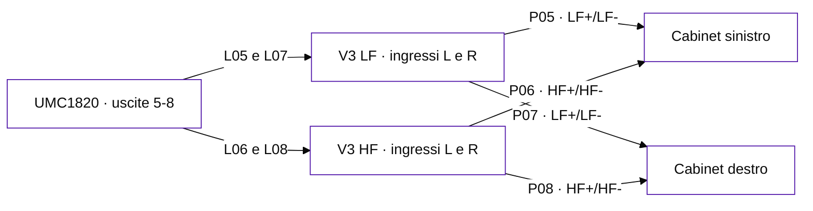

# Cablaggio delle quattro vie UMC1820 e V3

MS-324, 26 novembre 2026. Questo schema traduce la [catena di riferimento](67-catena-di-riferimento-e-dipendenze-esecutive.md) in collegamenti numerati. Per C-01 si propone di qualificare prima il cavo diretto con ring isolato per contenere la spesa. Una conversione passiva copre il caso in cui la diagnosi rilevi un problema di massa o il diretto non abbia un riferimento di segnale adatto. Entrambi i percorsi sono candidati. La qualifica elettrica e il rilascio del cablaggio restano sospesi per ADR-055. Le fonti e la copertura delle letture sono registrate nel [vault](../research-vault/catena-riferimento-20261126/c01.md).

## Schema e identificativi

| Linea | Line Out e indice del modello | Ingresso V3 | Coppia di potenza e destinazione |
|---|---|---|---|
| L05 | 5, indice 4 | LF sinistro, RCA bianco | P05, LF-L +/- → sinistro LF+ e LF- → woofer |
| L06 | 6, indice 5 | HF sinistro, RCA bianco | P06, HF-L +/- → sinistro HF+ e HF- → tweeter |
| L07 | 7, indice 6 | LF destro, RCA rosso | P07, LF-R +/- → destro LF+ e LF- → woofer |
| L08 | 8, indice 7 | HF destro, RCA rosso | P08, HF-R +/- → destro HF+ e HF- → tweeter |

LF identifica il gruppo woofer e HF il gruppo tweeter. La polarità della tabella identifica la continuità elettrica del cablaggio. La polarità acustica del filtro verrà decisa dalle misure e registrata nel profilo. Le cuffie restano assegnate a playback 3/4. Sulle uscite 5-8 il volume comune viene dal DSP.

## Variante D, collegamento diretto da qualificare per primo

Per ogni linea il cavo ha un jack TRS maschio da 6,35 mm lato UMC1820 e un RCA maschio lato V3. Tip va al contatto centrale RCA. Sleeve va alla corona RCA tramite lo schermo, che qui porta anche il ritorno. Ring è aperto e isolato. L'identificativo L05-L08 va su entrambe le estremità. Sono quattro cavi mono con pinout esplicito. Un jack TS unisce ring e sleeve nella presa TRS e resta fuori da questa variante. Anche gli adattatori preconfezionati vanno identificati per continuità prima di attribuire loro questo schema.

Behringer dichiara TRS bilanciato e massimo +16 dBu. Il resoconto su un esemplare con solo tip pilotato rende il diretto plausibile. Va ancora accertato il comportamento delle uscite effettive fra tip, ring e sleeve sotto carico di linea. Un'uscita flottante può richiedere un ricevitore differenziale per chiudere il percorso del segnale. Un'uscita simmetrica può invece presentare sul solo tip circa metà della tensione differenziale ideale. La perdita di 6 dB vale per quel secondo caso, con due ampiezze idealmente uguali e opposte. [QSG UMC1820 V8](https://cdn-media.empowertribe.com/2b9a46d7e1104b78b8881f726c18a4d0/QSG_BE_0805-AAN_UMC1820_WW.pdf), [osservazione Cameratim](https://www.cameratim.com/reviews/audio/behringer-u-phoria-umc1820-audio-interface/), [Jensen AN-003](https://www.jensen-transformers.com/wp-content/uploads/2014/08/an003.pdf).

## Variante I, ingresso differenziale con isolamento

Due ART DTI forniscono due canali ciascuno. Ogni linea ha un tratto TRS-TRS da UMC1820 a ingresso DTI e un tratto RCA-RCA da uscita DTI a V3. I cavi TRS mantengono continuità tip-tip, ring-ring, sleeve-sleeve. Il primario riceve la differenza tip-ring. Il secondario porta segnale e ritorno al centro e alla corona del suo RCA. Ogni tratto ha l'etichetta di linea con suffisso `-A` prima del DTI o `-B` dopo il DTI. DTI-LF usa canale 1 per L05 e canale 2 per L07. DTI-HF usa canale 1 per L06 e canale 2 per L08. Si usa una sola presa d'ingresso e una sola d'uscita per canale, conservando il collegamento di telaio definito dal costruttore sul canale 1. Il tratto sbilanciato è quello vicino al finale. [Manuale ART DTI 1.4](https://artproaudio.com/imgs/file/Manuals/om-DTI_Manual_A6_V1_4.pdf).

Il rapporto nominale 1:1 conserva circa il livello differenziale a vuoto. Il manuale indica una perdita di 0,4 dB su 100 kΩ e 5,5 dB su 600 Ω. La risposta dichiarata 10 Hz-50 kHz è ±5 dB a +4 dBu. Queste specifiche rendono plausibile l'interfaccia, ma richiedono una misura con il V3 per il bersaglio acustico del progetto. La distorsione pubblicata a 100 Hz e +24 dBu descrive la condizione di quella misura. La prestazione a 60 Hz e al livello effettivo va osservata. Un trasformatore 1:1 non costituisce un attenuatore di protezione.

## Bilancio di livello e prove differite

Con il riferimento di 0,775 V RMS, +16 dBu equivale a 4,890 V RMS. Se questo massimo corrispondesse a 0 dBFS sul percorso selezionato, -40 e -20 dBFS varrebbero rispettivamente 48,9 e 489 mV RMS. Sono riferimenti di calcolo per impostare l'acquisizione. Il rapporto reale fra campione e tensione dipende dal percorso, dal carico e dalla variante. La scheda del V3 stereo non pubblica il massimo livello RCA o il guadagno alla posizione scelta della manopola. I valori 24-48 V del manuale riguardano l'alimentazione DC. [Manuale Fosi V3 stereo](https://fosiaudio.com/pages/user-instruction-v3).

Il progetto usa come criterio preliminare per il solo collegamento ±0,2 dB tra 60 Hz e 20 kHz, dopo normalizzazione a 1 kHz. Riserva un decimo della tolleranza acustica di ±2 dB al contributo della linea. Restano da definire sul banco il margine numerico di rumore e il livello massimo autorizzato. Per ogni ramo si prendono il primo livello di non linearità osservato a monte e il limite di tensione differenziale ammesso sul carico. Il limite operativo è quello più restrittivo con margine, includendo picchi ed eventuali rialzi del crossover. Una correzione di guadagno può compensare una perdita costante purché lasci margine. Distorsione, saturazione o ronzio richiedono un'altra soluzione.

| Verifica differita | Confronto e criterio | Evidenza |
|---|---|---|
| Continuità a cavi scollegati | Ring aperto nella D, tre conduttori distinti nei tratti I. Ogni coppia di potenza isolata dalle altre e dal telaio. | Tabella contatto per contatto e sigle dei cavi |
| Mappa e livello a monte del finale | Una linea per volta e le altre mute. Misura differenziale ad alta impedenza tip-ring e riscontro dei due poli rispetto allo sleeve. Ripetere con il carico di linea previsto e verificare polarità e corrispondenza L05-L08. | Tracce e tensioni con riferimento comune, percorso PC/Pi e carico indicati |
| Trasferimento e disturbi | Confronto D/I con stesso livello ricevuto e stesso assetto di misura. Sweep normalizzato, fase attorno all'incrocio, rumore in mute e righe di rete con i quattro collegamenti presenti. Il riferimento di rumore dello strumento va registrato. | Risposta, spettro e differenze per via in entrambe le modalità host |
| Margine del finale | Prima dei trasduttori, carico fittizio idoneo e misura differenziale isolata ai capi di ciascuna coppia. Aumentare dal basso entro limiti di banco e osservare non linearità, tensione e picchi. | Posizione delle manopole, guadagno e margine per via, arresto prima di superare i limiti del carico |

I terminali dei finali sono coppie indipendenti. Lo schermo RCA e il negativo di potenza appartengono a circuiti diversi. Nessun polo di uscita dei V3 va portato a terra con la pinza dello strumento. Prima della qualifica si conservano profilo dimostrativo, mute e attesa silenziata. L'eventuale attenuatore, la protezione del tweeter e il limite operativo saranno scelti sulla misura del ramo reale. Il piano lascia le attività di banco sospese.

## Distinta di variante e disposizione

| Voce | Variante D | Variante I |
|---|---|---|
| Linee mono | 4 TRS-RCA con ring aperto | 4 TRS-TRS e 4 RCA-RCA, 2 ART DTI |
| Potenza | 4 coppie, due per cabinet | 4 coppie, due per cabinet |
| Passaggio a ogni cabinet | 4 poli isolati, LF+/LF- e HF+/HF- | 4 poli isolati, LF+/LF- e HF+/HF- |
| Alimentazione | 2 alimentatori V3 esterni | 2 alimentatori V3 esterni, DTI passivi |

I due finali vanno raggruppati sul lato raggiungibile per taratura, con ventilazione libera. Se servono i DTI, trovano posto vicino ai finali. Il layout tiene i cavi di linea separati dai cablaggi di alimentazione e potenza. Si riserva per ciascun cabinet un passaggio a quattro poli e un fermacavo. Lunghezze, connettore posteriore e quote di fissaggio si ricavano dal layout esecutivo tenendo conto di accesso e raggio di curvatura. Per A24, il [capitolo69](69-retro-a24-e-passaggio-cavi.md) specifica il candidato NL4MPXX su piastra e collega le coppie ai contatti 1 e 2. Le quote sono di studio.

Nella variante I gli isolatori aggiungono 154 € ai prezzi osservati, IVA inclusa. Il totale indicativo diventa 1021,25-1241,25 € prima dell'eventuale costo dei cavi aggiuntivi oltre il lotto stimato e della spedizione. Il confronto già registrato con due A800 è 1027,25-1247,25 €. Restano 6 € di differenza nominale prima dei cavi extra. Il ramo D resta prioritario per risparmiare se supera la futura qualifica. Se serve I, la convenienza va rivalutata sulla distinta completa al momento del preventivo. [ART DTI, Thomann Italia](https://www.thomann.it/art_dti.htm), [budget di base](67-catena-di-riferimento-e-dipendenze-esecutive.md#revisione-commerciale-e-budget).
